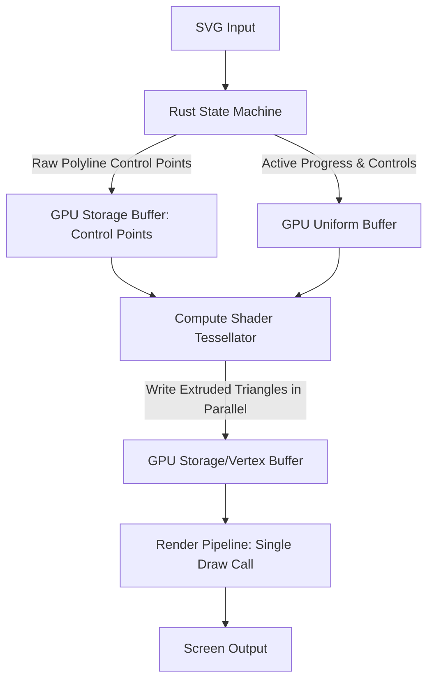

# WebGPU Compute Shader Tessellation & Parallel Rendering Plan

This document outlines the architectural design for migrating stroke geometry generation (tessellation/extrusion) from the CPU (Rust/WASM) to a **WebGPU Compute Shader** pipeline, introducing massive GPU-level parallelism.

---

## 1. Core Objectives & Parallelism Improvements

The current architecture performs CPU-bound line extrusion and uploads vertices segment-by-segment. This requires multiple buffer bindings and draw calls per frame.

Moving to a Compute Shader yields two major performance improvements:

### A. Massively Parallel Computation (Tessellation)
* **WASM Decoupling**: Rust no longer runs the geometry extrusion logic. It only manages the animation state machine, feeding raw control point coordinate arrays to the GPU.
* **Massive Concurrency**: The GPU dispatches a grid of threads where each thread or workgroup processes a single stroke segment in parallel. Normal vectors, bevel joints, and vertex coordinates are calculated simultaneously across thousands of GPU cores.

### B. Single Draw Call Rendering (Parallel Rasterization)
* **Unified Vertex Layout**: The compute shader writes the computed vertices into a single, contiguous **Vertex Storage Buffer**.
* **Zero Binding Overhead**: Instead of looping through strokes and submitting a draw call for each stroke (requiring 15+ separate draw calls and vertex buffer binds for complex characters), all dry strokes are drawn in a **single, unified draw call**:
  ```javascript
  // Bind the single contiguous compute-generated buffer
  passEncoder.setVertexBuffer(0, AppState.computeVertexBuffer);
  
  // Draw all completed strokes in one command
  passEncoder.draw(totalDryVertices);
  ```

---

## 2. High-Level Data Flow



---

## 3. WebGPU Resource & Buffer Layouts

### 1. Control Points Storage Buffer (`read-only storage`)
Holds the raw 2D coordinates of all stroke segments.
```wgsl
struct ControlPoint {
  position: vec2<f32>,
  stroke_index: u32,
  segment_index: u32,
};
@group(0) @binding(0) var<storage, read> control_points: array<ControlPoint>;
```

### 2. Stroke Metadata Storage Buffer (`read-only storage`)
Provides metadata to locate each stroke's start offset and segment count.
```wgsl
struct StrokeMeta {
  start_index: u32,
  point_count: u32,
  line_weight: f32,
  color: vec4<f32>,
};
@group(0) @binding(1) var<storage, read> strokes_meta: array<StrokeMeta>;
```

### 3. Output Vertex Storage Buffer (`storage, read_write`)
The destination buffer where the compute shader writes extruded vertices. This is subsequently bound as a **Vertex Buffer** for rendering.
```wgsl
struct ExtrudedVertex {
  position: vec2<f32>,
  color: vec4<f32>,
};
@group(0) @binding(2) var<storage, read_write> output_vertices: array<ExtrudedVertex>;
```

---

## 4. Compute Shader (WGSL) Outline

Each GPU thread computes the extrusion offsets for a single segment, writing the resulting 6 vertices (forming 2 triangles) to the output storage buffer.

```wgsl
struct Uniforms {
  current_stroke_index: u32,
  stroke_progress: f32,
  drying_progress: f32,
};
@group(0) @binding(3) var<uniform> uniforms: Uniforms;

@compute @workgroup_size(64)
fn cs_main(@builtin(global_invocation_id) global_id: vec3<u32>) {
  let segment_idx = global_id.x;
  // Read control points [segment_idx] and [segment_idx + 1]
  // Compute line segment direction and normal: normalize(-dy, dx)
  // Extrude points based on line_weight
  // Write 6 vertices directly to output_vertices at (segment_idx * 6)
}
```

---

## 5. Incremental Implementation & Risk Mitigation

To ensure zero disruption to the existing working application, we will introduce this path as a **third rendering mode**:

1. **Keep Existing Modes**: Retain `webgpu` (CPU-tessellated WebGPU) and `canvas` (Canvas 2D fallback).
2. **Add `webgpu-compute`**: Implement the new compute pipelines and shaders independently.
3. **Toggle Support**: Allow users to click the status badge to cycle through all three modes (`WebGPU (Compute)` -> `WebGPU (CPU)` -> `Canvas 2D Fallback`) to easily compare performance and visual output.
