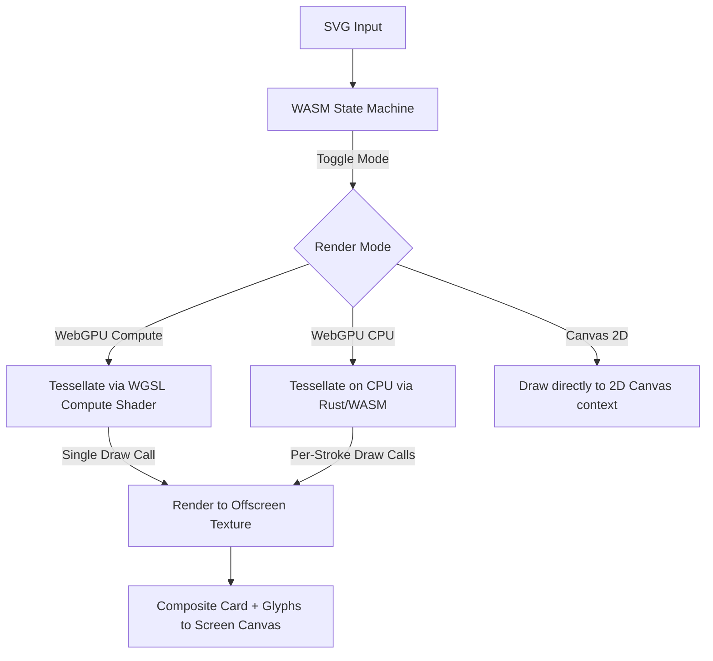

# Rendering & Code Guide: WebGPU Kanji Renderer

This guide explains the rendering pipelines, project structure, and stroke drawing implementation of the WebGPU Kanji Renderer, specifically comparing the WebGPU rendering path with the HTML5 Canvas fallback path.

---

## 1. Project Architecture

The application is modularized into the following subscripts and components:
* **[index.html](index.html)**: Defines the layout, glassmorphic UI controls, and a hidden `#svg-helper` used to extract path lengths.
* **[styles.css](styles.css)**: Implements custom glassmorphism styling, layout grids, slider designs, and dark-theme colors.
* **[app.js](app.js)**: Entry point orchestrating the initialization of WASM, starting UI hooks, and running the `frame(now)` render loop.
* **[animation_common.js](animation_common.js)**: Defines the shared global `AppState` object, control synchronizations, and async SVG interpreters.
* **[animation_webgpu.js](animation_webgpu.js)**: Manages the WebGPU pipeline setups, WGSL shader strings, and static/dynamic buffer uploads.
* **[animation_canvas.js](animation_canvas.js)**: Handles the 2D HTML5 Canvas fallback rendering path.
* **[web_support.js](web_support.js)**: Manages DOM binding listeners, sliders, sparkle animations, and URL sharing options.
* **[src/](src/)**: Rust/WASM state machine managing timing logic and polyline coordinates.

---

## 2. The Rendering Pipeline

The project implements three distinct rendering paths, which can be cycled by clicking the status badge:



### A. WebGPU (Compute) Mode (GPU-Parallelized)
* **Goal**: Move the heavy computational task of polyline triangulation/extrusion to the GPU and draw the whole character in a single command.
* **Tessellation**: The GPU dispatches a grid of compute shader threads. Each thread processes a single stroke segment in parallel, reading raw 2D coordinates from a `control_points` storage buffer and metadata from a `strokes_meta` storage buffer.
* **Animation & Coloring**: The compute shader reads active drawing progress, drying states, and line weights from a small uniform buffer, interpolating segment coordinates and vertex colors dynamically.
* **Single Draw Call**: The compute shader writes output vertices into a single contiguous `computeVertexBuffer`. The entire character (including guide, dry, and active strokes) is rendered in a **single draw call** (`passEncoder.draw(cpLen * 6)`), eliminating CPU-GPU state bind transitions.

### B. WebGPU (CPU) Mode (VRAM-Cached)
* **Goal**: Traditional CPU-side tessellation with stroke-by-stroke VRAM caching.
* **Glyph Offscreen Render**: Cleared to transparent black `{r:0, g:0, b:0, a:0}`.
* **Tessellation & VRAM Caching**:
  - **Static Guides & Dry Strokes**: Extruded once during character load on the CPU and cached permanently in dedicated VRAM `GPUBuffers` (one per stroke), eliminating per-frame copies.
  - **Dynamic Elements**: The active stroke, comet trails, and glow rings are extruded on the CPU each frame and copied to a small dynamic `drawVertexBuffer`.
* **Execution**: Renders the cached and dynamic buffers sequentially via multiple quick draw calls onto the offscreen `glyphTexture`.

### C. Screen Compositing (Pass 2)
* **Target**: The presentation canvas context texture view.
* **Operation**: Renders a screen-aligned quad (two triangles forming a full-screen card) using the main render `pipeline`.
* **Vertex Shader**: Positions the quad on screen and scales it based on the aspect ratio and zoom controls.
* **Fragment Shader** (`wgslShaders` -> `fs_main`):
  1. Computes the glass card background color.
  2. Generates subtle glowing neon borders using distance-to-edge calculations.
  3. Samples the offscreen glyph texture containing the drawn strokes.
  4. Composites the glass backing and the glowing strokes using **pre-multiplied alpha blending** to prevent color/transparency artifacts.

---

### B. The HTML5 Canvas Path (2D Fallback)

When WebGPU is unsupported or disabled (via the status badge toggle), the application falls back to standard 2D Canvas rendering:

1. **Clear Screen**: Draws a solid black rectangle over the canvas viewport.
2. **Guide Strokes**: Standard paths are drawn with a faint translucent white stroke.
3. **Completed Strokes**: Completed paths are drawn with a stroke color and width calculated by interpolating from active yellow/thick to dry blue/thin based on their completion timestamp.
4. **Active Stroke Segment**: Draws the current active stroke. If in "One Stroke" mode, it dynamically thins and colors the stroke from yellow to blue.
5. **Tip Effects**: Draws the radial gradient glow circle and the comet trail history of circular segments.

---

## 3. Stroke Drawing: WebGPU vs. Canvas

The core difference between WebGPU and Canvas lies in how vector lines are modeled and rasterized.

### A. Built-in Primitives Comparison

| Feature | HTML5 Canvas | WebGPU |
| :--- | :--- | :--- |
| **Primitives** | Paths, Curves, Arcs, Rectangles | Points, Lines (1px thin only), Triangles |
| **Stroke Extrusion** | Native (via `ctx.lineWidth`) | Manual CPU-side CPU tessellation (triangulation) |
| **Line Joins / Caps** | Native (`lineJoin`, `lineCap`) | Manual geometry generation (triangle fans for circles) |
| **Line Truncation** | Native (via `setLineDash`) | Manual math-based polyline truncation |

---

### B. CPU-Side Tessellation Details (`tessellate_stroke`)

Because WebGPU cannot natively draw thick, round-jointed lines, the Rust-side engine in [src/lib.rs](src/lib.rs) manually extrudes polylines into triangles:

#### 1. Segment Extrusion (Quads)
For every line segment from $P_1$ to $P_2$:
* The direction vector is calculated, and its perpendicular normal vector $\vec{U} = (-dy, dx)$ is normalized.
* The segment is offset outwards on both sides by the half-width radius $R = W / 2$:
  $$L = P + \vec{U} \cdot R \quad \text{and} \quad R_{offset} = P - \vec{U} \cdot R$$
* This creates four vertices ($L_1, R_1$ at start, $L_2, R_2$ at end) forming a rectangle (quad) around the segment.
* The quad is pushed into the vertex buffer as two triangles: `(L1, R1, L2)` and `(R1, R2, L2)`.

```
          L1 +---------------------------+ L2
             |                           |
    P1 (start) =========================== P2 (end)
             |                           |
          R1 +---------------------------+ R2
```

#### 2. Round Caps & Joins
* **Round Caps**: Circles are appended at the very start ($P_0$) and very end ($P_{n-1}$) of the polyline.
* **Round Joins**: Circles are appended at every intermediate vertex intersection between segments to cover gaps created when segments rotate relative to each other.
* The circle geometries are constructed via `append_circle_geometry` in [src/lib.rs](src/lib.rs) as a triangle fan consisting of 16 segment slices.

#### 3. Line Truncation (Animation Progress)
* In Canvas, drawing progress is animated by setting a line dash array:
  `glyphCtx.setLineDash([currentLength, totalLength])`
* In WebGPU, this is handled during extrusion in Rust. The helper `truncate_polyline` in [src/lib.rs](src/lib.rs) steps along the polyline segments, calculates segment lengths, and returns a new shortened polyline that is cut off exactly at the animated progress length. Only this truncated polyline is passed to the tessellator.

### C. VRAM Geometry Caching

To avoid generating and uploading the entire character's stroke geometries on every frame, the renderer divides vertices into static and dynamic buffer categories:

1. **Static Buffer Cache**:
   - **Guide Strokes**: Extruded once using the default guide line weight ($4\text{px}$) and translucent color (`rgba(255, 255, 255, 0.08)`) during character load. Stored in static `GPUBuffers` on VRAM.
   - **Dry Strokes**: Extruded once using the default dry line weight and blue color. Stored in static `GPUBuffers` on VRAM.
   - **Clean-Up**: If the character changes, these static VRAM buffers are destroyed (`buf.destroy()`) and rebuilt for the new character (even if WebGPU mode is temporarily disabled, preventing memory leaks and visual remnants).

2. **Dynamic Buffer**:
   - Only the currently active drawing stroke, active comets, and glowing tip rings are extruded on the CPU and copied to a small, pre-allocated dynamic vertex buffer `drawVertexBuffer` on every frame.

3. **Draw Loop Selection**:
   - For all completed strokes $i < \text{currentStrokeIdx}$, the renderer draws directly from `dryStrokeBuffers[i]`.
   - For all future strokes $i \ge \text{currentStrokeIdx}$, the renderer draws from `guideStrokeBuffers[i]`.
   - For the active stroke, the renderer draws from the dynamic `drawVertexBuffer`.
   - This optimization reduces CPU-GPU memory writes by over 98% per frame.

### D. GPU-Side Tessellation (Compute Shader)

In WebGPU Compute mode, rather than doing line extrusion on the CPU, we pass raw stroke coordinates to the GPU and tessellate all stroke segments in parallel:

1. **Storage Buffers**:
   - **Control Points**: A read-only storage buffer containing the flat list of `(x, y)` point coordinates, `stroke_index`, and `accumulated_len` (distance from the start of its parent stroke).
   - **Strokes Metadata**: A read-only storage buffer containing each stroke's `start_index` in the control points array, total `point_count`, and `line_weight`.
   - **Output Vertices**: A read-write storage buffer where the compute shader writes the computed triangle vertices.

2. **Compute Thread Dispatching**:
   - The GPU dispatches one thread per control point.
   - Each thread $j$ reads control points $P_j$ and $P_{j+1}$. If they belong to the same stroke, they define a line segment.
   - The thread extrudes this segment into 6 vertices (forming 2 triangles with a 24-byte layout matching the drawing pipeline vertex format) and writes them to the output storage buffer at offset $j \cdot 6$.

3. **Active Stroke Truncation**:
   - For the active stroke, the compute shader compares each segment's $P_A$ and $P_B$ accumulated lengths with the target animated stroke length ($L_{target} = L_{total} \cdot \text{stroke\_progress}$).
   - Segments completely past $L_{target}$ are collapsed to zero-area triangles.
   - Segments containing $L_{target}$ are partially extruded up to an interpolated position:
     $$P'_{B} = P_A + (P_B - P_A) \cdot \frac{L_{target} - L_A}{L_B - L_A}$$

---

## 4. Tip Effects & Glow Pipelines

* **Comet Trail**: A historical trail of coordinate points (`strokeTipHistory`) is updated each frame. Both paths draw these points as overlapping circles that shrink in size and fade quadratically in opacity to `0.0` as the pause transition nears completion.
* **Glow Circle**: The glowing sun is rendered as a series of concentric rings. WebGPU utilizes a custom vertex/index generation helper `append_glow_circle_geometry` in [src/lib.rs](src/lib.rs) which outputs rings with falloff opacities, while Canvas utilizes `createRadialGradient` with quadratic color stops.
  - **Placement & Coordinates**: The glowing sun is centered exactly at the active stroke tip. In the CPU WebGPU path, this is the last coordinate pair in `trail_buffer` (when trail length > 0) or the point resolved at the current animated length. In the Canvas path, it is retrieved from `active_tip_x()` / `y()`.
  - **Sizing**: The glow circle's radius is scaled to `tip_radius * 4.5`.
  - **Layering Order & Visual Effect**:
    1. *Comet Trail* (Bottom): Overlapping circles fading towards the tail.
    2. *Glowing Sun* (Middle): Large concentric yellow gradient rings centered at the tip.
    3. *Active Tip* (Top): Solid red circle representing the active drawing tip.
    *Visual Effect*: Layering the translucent yellow sun behind the solid red active tip circle creates a pleasing aesthetic resembling a glowing sun with a hot red core.
  - **Decay**: During pause/drying transitions, the glow's alpha decays linearly as `1.0 - pause_progress`.
