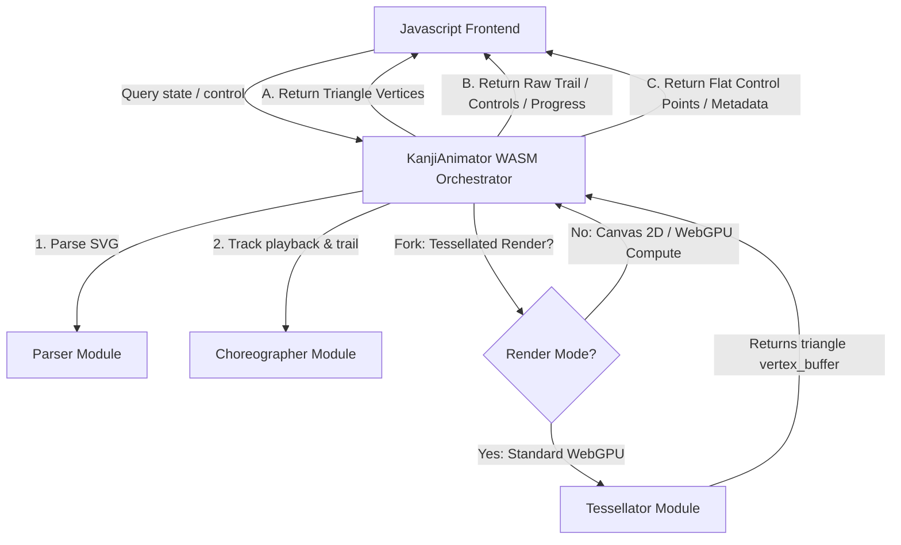

# Module Refactoring Pre-Analysis & Design Plan

This document details the division of `src/lib.rs` into three clean, encapsulated Rust modules:
1. **`parser`**: SVG path string parsing and curve subdivision.
2. **`choreographer`**: Playback timeline tracking, tick logic, and frame state coordination.
3. **`tessellator`**: CPU-based triangulation (extruding lines and caps to triangle lists) and GPU-buffer preprocessing.

The primary coordinator class `KanjiAnimator` (exposed to WebAssembly) acts as a thin orchestrator composing these three modules, maintaining a 100% backward-compatible API.



---

## 1. Module Interfaces

### Module A: SVG Path Parser (`src/parser.rs`)
Purely mathematical module. It parses SVG command streams and yields polyline segment points with precalculated chordal/arc lengths.

*   **Inputs**:
    *   `d: &str` (Standard SVG path `d` attribute string).
*   **Outputs**:
    *   `Stroke` struct: Contains the original path string and a list of polylines (`Vec<Vec<Point>>`), where each point has an accumulated `len` field precomputed.
*   **Data Structures**:
    ```rust
    #[derive(Clone, Copy, Debug)]
    pub struct Point {
        pub x: f32,
        pub y: f32,
        pub len: f32,
    }

    #[derive(Clone, Debug)]
    pub struct Stroke {
        pub path_d: String,
        pub polylines: Vec<Vec<Point>>,
    }
    ```
*   **Internal Helpers**: Bezier subdivisions (`subdivide_cubic`, `subdivide_quadratic`), tokenization (`tokenize`), and cleanup (`clean_polyline`).

---

### Module B: Animation Choreographer (`src/choreographer.rs`)
Stateful coordinator managing the timeline clock, playback mode, stroke progress, brush history, and active tip positions. It does not know how graphics are rendered or tessellated.

*   **Inputs**:
    *   `dt: f32`: Delta time step in seconds.
    *   `strokes: &[Stroke]`: The parsed strokes.
    *   `controls: &AnimationControls`: Timing parameters (speed, pause duration).
*   **Outputs (Queries)**:
    *   `current_stroke_index: usize`
    *   `stroke_progress: f32`
    *   `active_tip: Option<(f32, f32)>`
    *   `trail_buffer: &[f32]` (Pack of `x, y, progress, size` history)
    *   `dry_progress_buffer: &[f32]` (Fade factor for each stroke)
*   **Data Structures**:
    ```rust
    pub struct Choreographer {
        pub current_stroke_index: usize,
        pub stroke_progress: f32,
        pub stroke_time_elapsed_ms: f32,
        pub stroke_tip_history: VecDeque<Point>,
        pub stroke_completion_times: Vec<Option<f32>>,
        pub anim_time: f32,
        pub is_animating: bool,
        pub is_single_stroke_animating: bool,
        pub is_any_stroke_drying: bool,
        pub trail_buffer: Vec<f32>,
        pub dry_progress_buffer: Vec<f32>,
    }
    ```

---

### Module C: CPU Tessellator (`src/tessellator.rs`)
Computes triangle meshes for rendering. It manages two types of data: static cached stroke meshes (guide lines, completed "dry" strokes) and dynamic meshes rebuilt per frame (active drawing stroke, trail segments, and glowing tip).

*   **Inputs**:
    *   `strokes: &[Stroke]`
    *   `controls: &AnimationControls`
    *   `choreographer_state`: Exposes the current `current_stroke_index`, `stroke_progress`, `is_single_stroke_animating`, `dry_progress_buffer`, `trail_buffer`, etc.
*   **Outputs**:
    *   `vertex_buffer`: Triangle coordinates and color data (`[x, y, r, g, b, a]`).
    *   `flat_control_points`: Pre-processed control points mapped to canvas coordinate system.
    *   `flat_strokes_meta`: Stroke offsets for WebGPU compute bindings.
*   **Data Structures**:
    ```rust
    pub struct Tessellator {
        pub vertex_buffer: Vec<f32>,
        pub dry_stroke_cache: Vec<Option<Vec<f32>>>,
        pub guide_stroke_cache: Vec<Option<Vec<f32>>>,
        pub flat_control_points: Vec<WasmControlPoint>,
        pub flat_strokes_meta: Vec<WasmStrokeMeta>,
    }
    ```

---

## 2. Rendering Pipeline Fork: Tessellated vs. Non-Tessellated Paths

Depending on the active renderer (HTML5 Canvas 2D fallback, WebGPU standard rendering, or WebGPU compute shader pipeline), the orchestrator bypasses CPU tessellation entirely.

```
                  ┌──────────────────────────────────────────┐
                  │          KanjiAnimator (WASM)            │
                  └────────────────────┬─────────────────────┘
                                       │
                                       ▼
                       /───────────────────────────────\
                      <        Select Render Mode       >
                       \───────────────────────────────/
                               /       │       \
                              /        │        \
         Standard WebGPU Vertex        │         Canvas 2D Fallback
         ┌─────────────────────┐       │        ┌────────────────────┐
         │ Tessellator Active  │       │        │ Tessellator Bypass │
         └──────────┬──────────┘       │        └─────────┬──────────┘
                    │                  │                  │
                    ▼                  │                  ▼
           CPU-Tessellated Mesh        │         Raw Trail & Timings
           (vertex_buffer)             │         (get_trail_ptr)
                                       ▼
                             WebGPU Compute Shaders
                            ┌──────────────────────┐
                            │  Tessellator Bypass  │
                            └──────────┬───────────┘
                                       │
                                       ▼
                             Flat Control Points
                             (flat_control_points)
```

### Fork Case 1: Standard WebGPU Renderer (Tessellator Active)
*   **Path**: CPU Tessellation is **Required**.
*   **Flow**: The frontend calls `KanjiAnimator.tick(dt)`. The orchestrator executes the choreographer state update, then invokes `Tessellator.rebuild_vertex_buffer()`.
*   **Data Requested**: The frontend queries `get_vertices_ptr()` / `get_vertices_len()`.
*   **Outcome**: The GPU receives a fully computed index/vertex buffer representing ready-to-draw triangles of the strokes, caps, and glowing tips.

### Fork Case 2: HTML5 Canvas 2D Fallback (Tessellator Bypass)
*   **Path**: CPU Tessellation is **Bypassed**.
*   **Flow**: The frontend calls `KanjiAnimator.tick(dt)`, updating the choreographer's state. The tessellation step is skipped entirely.
*   **Data Requested**: The frontend queries `get_trail_ptr()`, `active_tip_x()`, `active_tip_y()`, and `get_dry_progress_ptr()`.
*   **Outcome**: Canvas 2D context draws lines and circles natively via path APIs (`ctx.lineTo()`, `ctx.arc()`), avoiding any triangle mesh creation overhead on the CPU.

### Fork Case 3: WebGPU Compute Pipeline (Tessellator Bypass)
*   **Path**: CPU Tessellation is **Bypassed** (Tessellation shifted to GPU).
*   **Flow**: The frontend calls `KanjiAnimator.tick(dt)`. The orchestrator skips CPU tessellation.
*   **Data Requested**: The frontend queries `get_control_points_ptr()` / `get_strokes_meta_ptr()` to populate the WebGPU compute shader storage buffers.
*   **Outcome**: The GPU compute shaders perform high-speed parallel stroke extrusion, glowing sun layer composition, and coordinates mapping directly in VRAM.

---

## 3. Mode Transition & Buffer Lifecycle Management

Switching between rendering modes (e.g., from Standard WebGPU to WebGPU Compute or Canvas 2D fallback) changes the CPU tessellator's state. To optimize memory footprint and ensure correctness, the buffers are managed dynamically during these transitions:

### Transition A: Entering Non-Tessellated Mode (Bypassing CPU Tessellation)
When switching from `webgpu_cpu` (Tessellator Active) to `webgpu_compute` or `canvas` (Tessellator Bypass):
1. **De-allocate Static Triangle Caches**: The static caches `dry_stroke_cache` and `guide_stroke_cache` contain heavy floating-point buffers. These are explicitly cleared (`clear()` and `shrink_to_fit()`) to release VRAM-mapped host memory.
2. **De-allocate Dynamic Vertex Buffer**: The frame-by-frame geometry buffer `vertex_buffer` is cleared and shrunken.
3. **WASM API Trigger**: The JS frontend calls `KanjiAnimator.disable_tessellation()`, signaling the orchestrator to dump these caches.

### Transition B: Entering Tessellated Mode (Activating CPU Tessellation)
When switching from `webgpu_compute` or `canvas` to `webgpu_cpu`:
1. **Rebuild Guide and Dry Meshes**: The static cached geometries (`guide_stroke_cache`, `dry_stroke_cache`) are fully re-tessellated based on current stroke lengths and stroke weight.
2. **Synchronize Dynamic Frame Geometry**: The orchestrator immediately calls `rebuild_vertex_buffer()` using the choreographer's active frame metrics (`current_stroke_index`, `stroke_progress`, trail history) to ensure that the initial frame drawn matches the animation's current timestamp.
3. **WASM API Trigger**: The JS frontend calls `KanjiAnimator.enable_tessellation()`, which allocates memory and rebuilds the static and dynamic meshes.
